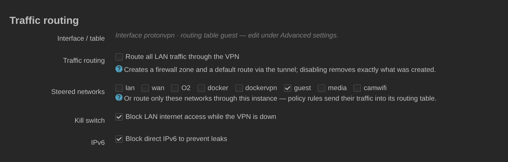

# Traffic-Routing

[English](routing.md) · [Русский](routing.ru.md) · **Deutsch** · [← README](../README.de.md)

Beim **automatischen Routing** legt das Backend eine Firewall-Zone an und
schickt den gesamten LAN-Traffic durch den Tunnel. Es rührt nichts an, sobald
es eine eigene Routing-Tabelle oder von dir hinzugefügte Routen erkennt.

Statt alles zu leiten, benenne **Quellnetzwerke**: nur diese verlassen den
Router durch den Tunnel, per Policy-Regeln in die eigene Routing-Tabelle der
Instanz. Der **Kill Switch** verhindert dann, dass diese Netzwerke das WAN
erreichen, während der Tunnel unten ist, und **`ipv6_mode`** entscheidet, was
mit IPv6 geschieht.

IPv6 ist bei ProtonVPN Sache des einzelnen Servers: nur ein Teil der Gateways
leitet es weiter, und Proton markiert diese mit Bit 16 der `Features`-Bitmaske
des logischen Servers. Auf 12 Gateways in 11 Ländern nachgemessen, jeweils mit
einer Anfrage an `2606:4700:4700::1111` durch den Tunnel: alle sechs mit dem Bit
antworteten in 0,02–1,07 s, alle sechs ohne das Bit liefen jedes Mal in einen
Timeout von 8–12 s, während der Sendezähler von WireGuard weiter stieg. Auf
einem solchen Server gehen die Pakete hinaus und nichts kommt zurück — das ist
kein „IPv6 aus“, sondern ein schwarzes Loch, und ein schwarzes Loch ist
schlimmer als eine Blockade: Clients warten bei jeder Verbindung Happy Eyeballs
ab, und alles, was kein Browser ist, hängt schlicht.

Daraus ergeben sich drei Modi:

* `block` (Vorgabe) — eine `prohibit`-Regel stoppt IPv6 auf den geleiteten
  Netzwerken, wie bisher.
* `auto` — auf einem Gateway mit dem Bit geht IPv6 durch den Tunnel, auf einem
  ohne das Bit greift dasselbe `prohibit` wie im Modus `block`. Die
  `prohibit`-Regel liegt unter der Lookup-Regel, aber über der Tabelle `main`,
  sodass ein liegender Tunnel oder ein Server ohne IPv6 dort endet und die
  Default-Route des Providers nie erreicht. Genau diese Reihenfolge ist der
  IPv6-Kill-Switch, und er steht, solange die Instanz aktiviert ist.

  Nur das Deaktivieren der Instanz nimmt ihn weg — und das muss es auch: mit
  dem Deaktivieren bekommen die geleiteten Netzwerke ihre normale Adressierung
  zurück, die Clients halten also wieder eine Provider-Adresse. Ein danach
  stehen gebliebenes `prohibit` schützt nichts und zerbricht alles: es weist
  jedes IPv6-Paket aus diesen Netzwerken ab und übersteht als netifd-Konfig
  jeden Neustart. Wer die Absicherung ohne Deaktivieren loswerden will, nimmt
  `off`.
* `off` — die App fasst IPv6 überhaupt nicht an.

`auto` gilt nur für geleitete Netzwerke; bei `auto_routing` gibt es keine
Regeln pro Netzwerk, an die es sich hängen ließe, also verhält es sich wie
`block`. Die Tunnel-Adresse selbst ist ein festes `/128`, das sich alle
Proton-Clients teilen — es gibt kein Präfix zu delegieren. Unter `auto` werden
die geleiteten Netzwerke deshalb aus der ULA des Routers adressiert
(`ip6assign 64`, `ip6class local`, `delegate 0`) und hinter der Firewall-Zone
der Instanz per NAT6 übersetzt. Der Client sieht dann nur eine ULA und keine
Provider-Adresse, und genau das hindert Happy Eyeballs daran, das WAN
vorzuziehen. Ein Präfix zuzuteilen heißt aber nicht, es anzukündigen: in einem
Netzwerk, in dem IPv6 nie benutzt wurde — `ra 'disabled'`, wozu die frühere
Blockade-Politik geradezu einlud — bekäme der Client überhaupt keine Adresse.
Deshalb schaltet `auto` für diese Netzwerke auch das Router Advertisement ein
(`ra 'server'`, `ra_slaac 1`) und setzt `ra_default 1`; ohne das kündigt odhcpd
auf einem Interface mit ausschließlich ULA eine Router-Lifetime von 0 an, und
der Client erhält eine Adresse, mit der er nicht routen kann.

Ausserdem werden zwei Überbleibsel eines Netzwerks entfernt, das zuvor hinter
einem ISP-Relay hing: `ra_flags` (die Flags *managed* und *other
configuration*) und `ndp`. Das M-Flag schickt den Client zu DHCPv6, um eine
Adresse zu holen, die das Advertisement bereits mitbringt — reine Verzögerung
beim Umschalten, und ein Client ganz ohne DHCPv6 wartet auf etwas, das nie
kommt. `ndp 'relay'` leitet Neighbour Discovery zum Uplink weiter und hält
damit den Weg zum Provider-Router genau für die Clients offen, die gerade davon
weggeholt werden. DHCPv6 selbst bleibt in beide Richtungen unangetastet:
`auto` schaltet keinen Server ein, den Sie ausgeschaltet haben, und keinen aus,
den Sie eingeschaltet haben. Mit gelöschtem M-Flag fordert nichts mehr einen
Client auf, ihn nach einer Adresse zu fragen, also nimmt er an der
Adressvergabe nicht mehr teil — er läuft aber weiter und antwortet dem, der
von sich aus fragt. Genau darum geht es: es ist Ihr Dienst, und er tut
weiterhin, wofür Sie ihn eingerichtet haben.

Die Adressierung zu ändern ist nicht dasselbe, wie sie von den Clients benutzen
zu lassen. Die unaufgeforderten Advertisements von odhcpd liegen Minuten
auseinander — auf dem gemessenen Router zehn — und ein Client, der das
entscheidende verpasst hat, behielt seine Provider-Adresse bis zum nächsten.
Beim Übernehmen wie beim Freigeben eines Netzwerks wird deshalb gewartet, bis
netifd die neue Adressierung meldet, und dann odhcpd zum erneuten Ankündigen
aufgefordert — was es die von RFC 4861 vorgesehene Anfangsserie senden lässt
statt eines einzelnen Pakets. In beide Richtungen: ohne das behalten die
Clients beim Freigeben eine ULA, die nirgends mehr hinführt. Für einige Minuten
danach sagt die Statuskarte, dass die Clients noch umziehen, damit „IPv6 ist
aktiv" nicht als „alle Geräte benutzen es bereits" gelesen wird.

Zusätzlich wird Neighbour Discovery für die geleiteten
Netzwerke geöffnet — Router Solicitation sowie Neighbour
Solicitation/Advertisement, ausschließlich IPv6 und sonst nichts, gebunden an
das Interface des Netzwerks selbst, sodass nichts anderes aus seiner
Firewall-Zone erfasst wird. Eine
Gast-Zone weist ab, was sie nicht ausdrücklich nennt, und Neighbour Discovery
nennt dort niemand; ohne das kann der Router die Adresse eines Clients nicht
auflösen, und jede Antwort aus dem Tunnel geht auf dem letzten Stück
verloren. Sowohl die Netzwerk- als auch die `dhcp`-Einstellungen gehören
dir, also werden die vorigen Werte gemerkt und zurückgeschrieben, sobald `auto`
abgeschaltet wird. Hat der Router kein eigenes ULA-Präfix, gibt es nichts zu
verteilen — das steht dann im Log, statt still zu scheitern.

Für welche Netzwerke das gilt, wird entschieden, bevor irgendetwas geschrieben
wird, und die drei Teile — Adressierung, Ankündigung, Öffnung — werden
gemeinsam gewährt oder gemeinsam verweigert: Ein Client, der eine ULA bekommt
und diesen Router als Standard-Gateway genannt bekommt, dessen Netzwerk
Neighbour Discovery dann aber verweigert wurde, hat eine Adresse, die er nicht
benutzen kann, und erfährt es nicht. Ein Netzwerk qualifiziert sich, wenn es
eines ist, in dem der Router Clients bedient: ein Protokoll, mit dem er nicht
nach außen wählt, keine eigene Standardroute, eine Firewall-Zone, an die sich
die Regel hängen lässt, und genau ein Gerät, an das sie gebunden werden kann.
Die letzte Frage wird dem Gerät gestellt und nicht dem Netzwerk, denn ein Alias
oder ein zweites Subnetz kann auf derselben Bridge liegen und ein eigenes
Gateway führen, und eine Regel, die auf das Gerät passt, würde es mit erfassen.
Ein Netzwerk, das sich nicht qualifiziert, bleibt genau so, wie du es hattest,
und das Log nennt das Netzwerk und den Grund.

`auto` richtet sich nach der Flotte, statt sie einzuschränken: du landest auf
dem Gateway, das die Auswahl hergibt, und IPv6 wird entsprechend geleitet oder
verboten. Wer lieber IPv6 hat als die größte Serverauswahl, dreht das mit
**`require_ipv6`** um: dann kommen nur noch Gateways mit dem Bit in Frage — für
die erste Verbindung, für jede Rotation und für die Wiederherstellung durch den
Watchdog gleichermaßen, nicht bloß in der angezeigten Liste. 11 832 von 17 890
logischen Servern qualifizieren sich (66 %), und in manchen Ländern gibt es
kein einziges.

Enthalten die gewählten Standorte kein solches Gateway, verbindet sich die
Instanz nicht und sagt das auch. Ein Rückfall auf ein Gateway ohne IPv6 findet
nie statt: du hast IPv6 ausdrücklich verlangt, und eine Verbindung, die
stillschweigend das Gegenteil liefert, ist genau der Fehler, den dieses Feature
verhindern soll. Ein angepinnter `fixed_server` ohne das Bit wird aus demselben
Grund abgelehnt — Anpinnen deaktiviert die Rotation ohnehin, du bliebest also
dauerhaft darauf sitzen. Erweitere die Standorte, wähle einen anderen Server
oder schalte die Anforderung ab.

Dasselbe gilt für einen bereits bestehenden Tunnel. Schaltest du die
Anforderung ein, während du auf einem Gateway ohne das Bit verbunden bist, und
lässt sich kein geeignetes erreichen, wird der Tunnel abgebaut statt
weiterzulaufen: ein solches Gateway nicht zu wählen und dich gleichzeitig
darauf weiterzutragen, hieße die Anforderung für gescheitert zu erklären und
sie im selben Moment zu brechen. Ein Tunnel, der die Anforderung erfüllt,
bleibt unangetastet. IPv6 entweicht dabei nicht — die `prohibit`-Regel steht,
ob der Tunnel oben oder unten ist, solange die Instanz aktiviert ist —, aber
IPv4 aus den geleiteten Netzwerken
geht bei liegendem Tunnel zu deinem Provider, genau wie nach jedem anderen
Verbindungsfehler. Schalte den Kill Switch ein, wenn dir lieber ist, dass diese
Netzwerke dann gar keinen Zugang haben.

Beide Hälften stehen dort, wo du sie siehst, und stammen aus dem Status, den
die Seite immer hat — nicht bloß aus der Antwort auf einen Klick: Das
Statusband nennt die Anforderung und — bei ausgeschaltetem Kill Switch — dass
die geleiteten Netzwerke jetzt über deinen Provider laufen, samt dem Hinweis,
den Kill Switch einzuschalten. Ein Reload, der Status-Poll und eine Rotation im
Hintergrund sagen dasselbe.

Es nennt außerdem, auf welche Weise die Anforderung unerfüllt blieb, denn die
Abhilfe unterscheidet sich: keines der Gateways in diesen Standorten
unterstützt IPv6 (nimm einen Standort dazu, der solche hat), die
IPv6-fähigen Gateways hier waren nicht erreichbar (sie leiten IPv6 weiter —
verbinde einfach neu, ohne etwas zu ändern), oder der angepinnte Server
unterstützt es nicht (wähle einen anderen).

Die Option gilt nur dort, wo `auto` IPv6 überhaupt liefern kann: mit
`ipv6_mode` `auto`, `hop_mode` `standard` und geleitetem Routing — also genau
unter den Bedingungen, die `auto` selbst braucht. Sonst deaktiviert die Seite
sie und nennt den Grund, und eine von Hand geschriebene Konfiguration, die
keine davon erfüllt, behält ihre ganze Flotte, statt an einer Option zu
scheitern, die nichts ändert. Außerhalb von `auto` geht IPv6
durch keinen Tunnel, welches Gateway auch gewählt wird — die Flotte zu
verkleinern kostete Server und brächte nichts; außerhalb von Standard ist die
Anforderung unerfüllbar, denn Bit 16 ist bei 0 von 122 Secure-Core- und 0 von 7
Tor-Logicals gesetzt. Der gespeicherte Wert übersteht einen Ausflug in die
anderen Modi, statt vergessen zu werden.

## Der Weg des Tunnels selbst

Die WireGuard-Pakete des Tunnels selbst müssen den Server über deinen echten
Uplink erreichen. Hat das Interface kein `nohostroute '1'`, legt netifd eine
Host-Route zum Server (dem Endpoint) an und nimmt sie, sich selbst überlassen,
von irgendeiner Route, die den Endpoint abdeckt — auch vom `0.0.0.0/0`, das der
Tunnel einer anderen Instanz in seiner Routing-Tabelle führt. Bei einem
WAN-Ausfall ist das die einzige Route, die bleibt: Ein Tunnel lief dann im
anderen, und blieb dort, als das WAN zurückkam.

Deshalb ermittelt das Backend vor jedem Verbinden, jeder Rotation, jedem
Rollback und jeder Wiederherstellung, welches Interface netifd wählen würde,
gäbe es keine Tunnel — die spezifischste Route zum Endpoint unter den
Interfaces, deren Gerät der Kernel selbst als Provideranbindung ausweist
(Ethernet, VLAN, Bridge, PPP, DS-Lite/MAP, ein LTE-Modem; nicht WireGuard,
tun/tap, GRE, VXLAN oder etwas darauf Aufgebautes) — und schreibt es als
`tunlink` in das Netzwerk-Interface; `protonvpn_tunlink` hält fest, dass das
Paket es geschrieben hat. Ab dann löst netifd den Endpoint nur noch über diesen
Uplink auf: Der Tunnel fällt mit ihm und kommt mit ihm zurück, auf jedem Weg,
ein Neustart oder ein von Hand ausgeführtes `ifup` eingeschlossen.

Deckt kein Uplink den Endpoint ab, wartet die Instanz, statt sich zu verbinden:
kein `ifup`, kein Serverwechsel, keine Versuche, die dem Watchdog angerechnet
werden. War sie noch nie gebunden, wird `tunlink` auf `protonvpn-no-uplink`
gesetzt, einen Namen, den kein Interface tragen kann, sodass auch netifd sie
nicht ungebunden starten kann. Status (`uplink_wait`) und Log sagen einmal,
warum. Wurde etwas anderes als ein Tunnel abgewiesen — etwa ein Uplink auf
einem Gerätetyp, den das Backend nicht kennt —, nennt das Log es und den
Ausweg: `nohostroute '1'` auf dem Interface, wenn du den Endpoint selbst
routest. Sie kommt von selbst zurück, sobald wieder ein Uplink den Endpoint
abdeckt — womöglich ein anderer als zuvor —, beim nächsten Interface-Ereignis
(ein Hook in `/etc/hotplug.d/iface`) oder innerhalb von 30 Sekunden (der Takt
des Dienstes).

Ein `tunlink`, den du selbst gesetzt hast, wird nie geändert, aber an dieselbe
Regel gehalten: Nennt er einen Tunnel (irgendein WireGuard-Interface, von
diesem Paket oder nicht) oder ein Interface, das unten ist oder den Endpoint
nicht abdeckt, wird die Instanz nicht darüber gestartet, und das Log sagt
einmal, warum. Routest du den Endpoint wirklich auf anderem Weg, setze
stattdessen `nohostroute '1'`.

Jede aktivierte Instanz — auch mit `nohostroute` oder selbst gesetztem
`tunlink` — wird außerdem geprüft, solange sie oben ist: Routet der Kernel
ihren Endpoint durch einen Tunnel, egal wer die Route gesetzt hat, steht `LEAK`
im Log, der Tunnel wird heruntergefahren und kommt auf demselben Weg zurück,
sobald die Route wieder in Ordnung ist, nach einer Pause, die sich mit jeder
Wiederholung verdoppelt (2 bis 15 Minuten). Für eine `nohostroute`-Instanz
heißt „in Ordnung“ alles, was kein Tunnel ist: Die Default-Route, die dein
Failover-Skript in `main` legt, passt; ansonsten wird sie weder gebunden noch
zurückgehalten. Bis dahin startet sie nichts — nicht der Watchdog, nicht die
geplante Rotation und auch kein Verbinden oder Rotieren von Hand: Diese werden
mit dem Grund („held after a leak“) abgelehnt.

Außerdem bekommt jede aktivierte Instanz eine netifd-Regel
`to <Endpoint> unreachable` mit Priorität 89999. Sie kommt nach `main` und
`default` und fängt nur, was beide verfehlen: netifd gibt jedem Interface mit
Routing-Tabelle eine Regel `iif lo lookup <Tabelle>` ab Priorität 90000, und
Traffic des Routers, der in `main` nichts findet, fiele sonst in die erste
Tunnel-Tabelle, auf die er trifft. Gegen eine schlechte Route, die bereits in
`main` steht, tut sie nichts; dafür ist die Prüfung oben da. Eine Regel in der
Konfiguration wirkt erst, wenn netifd sie geladen hat, deshalb folgt jeder
Änderung ein `network reload`, und ein fehlgeschlagener wird bei jedem Takt
des Dienstes wiederholt, bis er gelingt; steht nichts aus, wird nicht neu
geladen. Solange netifd das Eingetragene nicht geladen hat, wird kein Tunnel
gestartet: Die Instanz wartet mit dem Grund, dass das Neuladen fehlschlug, und
kommt von selbst, sobald eine Wiederholung gelingt.

Was garantiert ist und was nicht:

* Über eine Bindung kann netifd den Endpoint gar nicht auf einen Tunnel legen,
  und das erste Paket des Tunnels kann nicht vor der Host-Route hinaus: Das
  Setup-Skript legt das WireGuard-Gerät heruntergefahren an, und netifd bringt
  es erst mit dem Update hoch, das auf die Endpoint-Abhängigkeit folgt, wenn
  die Host-Route schon steht.
* Ohne Uplink wird nichts gestartet.
* Nicht verhindert, nur erkannt: eine Instanz, die netifd von selbst startet,
  bevor diese Version sie zum ersten Mal gebunden hat, oder eine schlechte
  Route, die jemand in `main` legt. Sie wird beim nächsten Interface-Ereignis
  heruntergefahren, oder innerhalb eines Takts (30 s), falls das Ereignis
  verloren geht.
* IPv6-Endpoints: Ob eine IPv6-Adresse eines Interfaces den Endpoint abdeckt,
  wird aus dem netifd-Dump gelesen, der nicht verrät, ob die Adresse off-link
  ist; eine solche Adresse gilt als on-link.

Das Entfernen des Pakets nimmt die Schutzregeln, die von ihm geschriebenen
`tunlink`-Werte (den Platzhalter eingeschlossen) und die Markierungen wieder
aus `/etc/config/network`; ein `tunlink` von dir bleibt. Ein Update behält sie.
Lädt netifd das Ergebnis nicht, schlägt das Entfernen fehl (der Dienst bleibt
gestoppt) und kann wiederholt werden, solange das Paket noch da ist.

