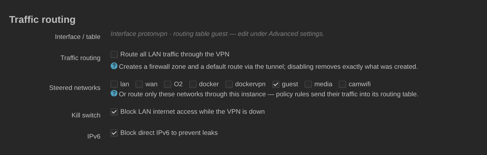

# Traffic routing

**English** · [Русский](routing.ru.md) · [Deutsch](routing.de.md) · [← README](../README.md)

With **automatic routing** the backend creates a firewall zone and sends all
LAN traffic through the tunnel. It never touches anything if it detects a
custom routing table or routes you added yourself.

Instead of routing everything, name **source networks**: only those leave
through the tunnel, via policy rules into the instance's own routing table.
The **kill switch** then blocks those networks from reaching the WAN while the
tunnel is down, and **`ipv6_mode`** decides what happens to IPv6.

IPv6 is a per-server matter on ProtonVPN: only some gateways forward it, and
Proton marks them with bit 16 of the logical server's `Features` bitmask.
Measured on 12 gateways across 11 countries by probing `2606:4700:4700::1111`
through the tunnel — all six with the bit answered in 0.02–1.07 s, all six
without it timed out at 8–12 s every single time while the WireGuard transmit
counter kept climbing. On such a server the packets leave and nothing comes
back, which is not "IPv6 off", it is a black hole — and a black hole is worse
than a block: clients wait out Happy Eyeballs on every connection and anything
that is not a browser simply hangs.

So the three modes are:

* `block` (default) — a `prohibit` rule stops IPv6 on the steered networks, as
  before.
* `auto` — on a gateway with the bit, IPv6 goes through the tunnel; on one
  without it, the same `prohibit` as in `block`. The prohibit rule sits below
  the lookup but above the main table, so a down tunnel or a server without
  IPv6 stops there and never reaches your provider's default route. That
  ordering is the IPv6 kill switch, and it stays up for as long as the instance
  is enabled.

  Disabling the instance is the one thing that takes it down, and it has to:
  Disable also hands the steered networks their normal addressing back, so the
  clients are holding an ISP address again. A prohibit left standing after that
  guards nothing and breaks everything — it refuses every IPv6 packet from
  those networks, and being netifd config it survives a reboot. `off` is how
  you ask for no guard while the instance keeps running.
* `off` — the app does not touch IPv6 at all.

`auto` applies to steered routing only; with `auto_routing` there are no
per-network rules to attach it to, so it behaves as `block`. The tunnel's own
address is a fixed `/128` that every Proton client shares, so there is no
prefix to delegate: under `auto` the steered networks are addressed from the
router's own ULA (`ip6assign 64`, `ip6class local`, `delegate 0`) and NAT6'd
behind the instance's firewall zone. The client then sees a ULA and no ISP
address at all, which is exactly what keeps Happy Eyeballs from preferring the
WAN. Allocating a prefix is not the same as announcing one, though: on a
network where IPv6 was never used — `ra 'disabled'`, which is what the old
blocking policy encouraged — the client would end up with no address at all. So
`auto` also switches the router advertisement on for those networks
(`ra 'server'`, `ra_slaac 1`) and sets `ra_default 1`, without which odhcpd
advertises a router lifetime of zero on a ULA-only interface and the client
gets an address it cannot route with.

It also clears two things a network that used to sit behind an ISP relay
carries: `ra_flags` (the *managed* and *other configuration* flags) and `ndp`.
The M flag tells a client to go and ask DHCPv6 for an address the
advertisement it arrived in already carries — pure delay on the switch, and a
wait for nothing on a client with no DHCPv6 at all. `ndp 'relay'` proxies
neighbour discovery toward the uplink, which keeps the path to the ISP router
alive for exactly the clients being moved off it. DHCPv6 itself is left alone
in both directions: `auto` does not switch on a server you disabled, and does
not switch off one you enabled. With the M flag cleared, nothing tells a
client to ask it for an address, so it stops taking part in address
configuration — but it keeps running and keeps answering a client that asks
anyway, which is the point: it is your service and it still does whatever you
set it up to do.

Changing the addressing is not the same as the clients using it. odhcpd's
unsolicited advertisements are minutes apart — ten, on the router this was
measured on — so a client that missed the one carrying the switch kept its ISP
address until the next. Claiming or releasing a network therefore waits for
netifd to report the new addressing and then asks odhcpd to advertise again,
which makes it send the initial burst RFC 4861 prescribes rather than a single
packet. Both directions: without it on release, clients keep a ULA that no
longer routes anywhere. For a few minutes afterwards the status card says the
clients are still moving over, so "IPv6 is active" is not read as "every device
is already using it".

It also opens
neighbour discovery for the steered networks — router solicitation and
neighbour solicitation/advertisement, IPv6 only, nothing else, and bound to
that network's own interface so nothing else sharing its firewall zone is
covered. A guest-style zone rejects what it does not name, and nothing names
neighbour discovery, so without that the router cannot resolve a client's
address and every reply coming back through the tunnel is dropped on the last
hop. Both the network
and the `dhcp` settings belong to you, so the previous values are recorded and
put back when `auto` is switched off. If the router has no ULA prefix of its
own there is nothing to hand out, and the log says so rather than failing
quietly.

Which networks this applies to is decided before anything is written, and the
three parts — addressing, announcement, opening — are granted or refused
together: a client handed a ULA and told this router is its default gateway, on
a network whose neighbour discovery was then refused, has an address it cannot
use and no way to tell. A network qualifies when it is one the router serves
clients on: a protocol it does not dial out with, no default route of its own,
a firewall zone to attach the rule to, and a single device to bind it to. That
last question is asked of the device and not of the network, because an alias
or a second subnet can sit on the same bridge and carry a gateway of its own,
and a rule matching the device would cover it too. A network that does not
qualify is left exactly as you had it, and the log names the network and the
reason.

`auto` follows the fleet rather than narrowing it: you land on whatever gateway
the selection gives you, and IPv6 is routed or prohibited to match. If you
would rather have IPv6 than the widest choice of servers, **`require_ipv6`**
turns that around and only considers gateways that carry the bit — for the
initial connect, for every rotation and for the watchdog's recovery alike, not
merely in the list the page shows. 11 832 of 17 890 logicals qualify (66 %),
and some countries have none at all.

When the selected locations hold no such gateway, the instance does not
connect and says so. It never falls back to a gateway without IPv6: you asked
for IPv6 explicitly, and a connection that silently delivers the opposite is
the failure this whole feature exists to avoid. A pinned `fixed_server`
without the bit is refused on the same grounds — pinning already disables
rotation, so being left on it would be permanent. Widen the locations, pick a
different server, or turn the requirement off.

The same applies to a tunnel that is already up. If you turn the requirement on
while connected to a gateway without the bit and nothing eligible can be
reached, the tunnel is taken down rather than left running: declining to choose
such a gateway while still carrying you on one would report the requirement as
failed and break it at the same time. A tunnel that already satisfies the
requirement is left alone. IPv6 cannot escape either way — the prohibit rule
stays installed whether the tunnel is up or down, as long as the instance is
enabled — but IPv4 from the steered
networks falls back to your provider while the tunnel is down, exactly as it
does after any other connection failure. Turn the kill switch on if you would
rather those networks lose access than leave through the WAN.

Both halves are said where you will see them, and from the status the page
always has rather than only in the reply to the click: the band reports the
requirement, and — when the kill switch is off — that the steered networks are
now leaving through your provider, with the advice to turn the kill switch on.
A reload, the status poll and a background rotation all say the same thing.

It also says which way the requirement went unmet, because the remedies
differ: none of the gateways in these locations support IPv6 (add a location
that has them), the IPv6-capable gateways here could not be reached (they do
forward IPv6 — reconnect rather than changing anything), or the pinned server
does not support it (pick another server).

The option applies only where `auto` can actually deliver IPv6: with
`ipv6_mode` `auto`, `hop_mode` `standard`, and steered routing — the same
conditions `auto` itself needs. The page disables it elsewhere with the reason
shown, and a hand-written configuration that meets none of them keeps its whole
fleet rather than being refused over an option that changes nothing. Outside `auto` nothing
is routed through the tunnel whichever gateway is picked, so narrowing the
fleet would cost servers and buy nothing; outside Standard it cannot be
satisfied, because bit 16 is set on 0 of 122 Secure Core and 0 of 7 Tor
logicals. The stored value survives a trip through the other modes rather than
being forgotten.

## The tunnel's own path

The tunnel's WireGuard packets have to reach the server through your real
uplink. Unless the interface has `nohostroute '1'`, netifd installs a host
route to the server (the endpoint), and left to itself it takes that route from
whatever covers the endpoint — including the `0.0.0.0/0` another instance's
tunnel carries in its routing table. During a WAN outage that is the only route
left, so one tunnel ended up riding inside another, and stayed there after the
WAN came back.

So before every connect, rotation, rollback or recovery the backend works out
which interface netifd would choose if there were no tunnels — the most
specific route covering the endpoint, among interfaces whose device is a
provider attachment by the kernel's own account (Ethernet, VLAN, bridge, PPP,
DS-Lite/MAP, an LTE modem; not WireGuard, tun/tap, GRE, VXLAN or anything built
on them) — and writes it to the network interface as `tunlink`, with
`protonvpn_tunlink` recording that the package wrote it. From then on netifd
resolves the endpoint through that uplink and nothing else: the tunnel goes
down with it and comes back with it, on every path, a reboot or a hand-run
`ifup` included.

When no uplink covers the endpoint, the instance waits instead of connecting:
no `ifup`, no server rotation, no retries counted against the watchdog. If it
was never pinned, `tunlink` is set to `protonvpn-no-uplink`, a name no
interface can have, so netifd cannot start it unpinned either. The status
(`uplink_wait`) and the log say why, once. When something other than a tunnel
was turned away — an uplink on a device kind the backend does not recognise,
for instance — the log names it, and says that `nohostroute '1'` on the
interface is the way out if you route the endpoint yourself. It comes back by
itself as soon as an uplink covers the endpoint again — possibly another one
than before — on the next interface event (an `/etc/hotplug.d/iface` hook) or
within 30 seconds (the service tick).

A `tunlink` you set yourself is never changed, but it is held to the same rule:
if it names a tunnel (any WireGuard interface, this package's or not), or an
interface that is down or does not cover the endpoint, the instance is not
brought up through it, and the log says why once. If you really route the
endpoint by other means, set `nohostroute '1'` instead.

Every enabled instance — `nohostroute` and hand-set `tunlink` included — is
also checked while it is up: if the kernel routes its endpoint through a tunnel,
whoever put that route there, the log says `LEAK`, the tunnel is taken down,
and it comes back the same way once the route is sane again, after a pause that
doubles with every repeat (2 to 15 minutes). For a `nohostroute` instance
"sane" means anything that is not a tunnel: the default your failover script
puts into `main` is fine; it is never pinned or held back otherwise. Until
then nothing starts it — not the watchdog, not scheduled rotation, and not a
connect or rotation you start by hand either: those are refused with the
reason ("held after a leak").

Every enabled instance also gets a netifd rule `to <endpoint> unreachable` at
priority 89999. It comes after `main` and `default`, so it only catches what
both of them miss — netifd gives every interface with a routing table a rule
`iif lo lookup <table>` at 90000 and above, and router traffic that misses
`main` would otherwise descend into the first tunnel table it meets. It does
nothing about a bad route that is already in `main`; that is what the check
above is for. A rule written to the configuration only counts once netifd has
loaded it, so every change is followed by a `network reload`, and one that
fails is retried on every service tick until it succeeds; with nothing pending
no reload is made. Until netifd has loaded what was committed, no tunnel is
brought up: the instance waits, saying the reload failed, and comes up by
itself once a retry succeeds.

What this does and does not guarantee:

* Through a pin, netifd cannot put the endpoint on a tunnel at all, and the
  tunnel's first packet cannot leave before the host route exists: the setup
  script creates the WireGuard device down, and netifd brings it up only with
  the update that follows the endpoint dependency, after it has installed the
  host route.
* With no uplink, nothing is brought up.
* Not prevented, only detected: an instance netifd starts by itself before this
  version first pinned it, or a bad route someone puts into `main`. Those are
  taken down at the next interface event, or within one service tick (30 s) if
  that event is lost.
* IPv6 endpoints: whether an IPv6 address on an interface covers the endpoint
  is read from netifd's dump, which does not say whether the address is
  off-link; such an address is treated as on-link.

Removing the package takes the guards, the `tunlink` values it wrote (the
sentinel included) and the stamps back out of `/etc/config/network`; a
`tunlink` of yours stays. An upgrade keeps them. If netifd will not load the
result, the removal fails (with the service stopped) so it can be retried
while the package is still there.

