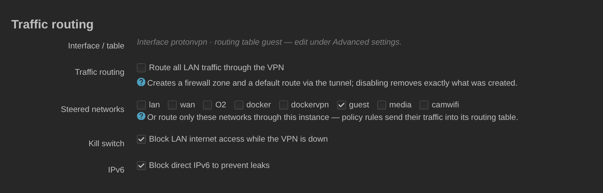

# Маршрутизация трафика

[English](routing.md) · **Русский** · [Deutsch](routing.de.md) · [← README](../README.ru.md)

При **автоматической маршрутизации** бэкенд создаёт зону файрвола и отправляет
весь трафик LAN через туннель. Он не трогает ничего, если обнаружит собственную
таблицу маршрутизации или маршруты, добавленные вами.

Вместо того чтобы гнать через туннель всё, укажите **исходные сети**: уйдут
только они — по policy-правилам в собственную таблицу маршрутизации инстанса.
**Kill switch** тогда закрывает этим сетям выход в WAN, пока туннель лежит, а
**`ipv6_mode`** решает, что делать с IPv6.

IPv6 у ProtonVPN — вопрос конкретного сервера: форвардят его только часть
шлюзов, и Proton помечает их битом 16 в маске `Features` логического сервера.
Замерено на 12 шлюзах в 11 странах запросами к `2606:4700:4700::1111` через
туннель: все шесть с битом ответили за 0.02–1.07 с, все шесть без бита каждый
раз уходили в таймаут на 8–12 с, причём счётчик отправленного у WireGuard при
этом рос. На таком сервере пакеты уходят и не возвращаются — это не
«IPv6 выключен», а чёрная дыра, а чёрная дыра хуже блокировки: клиенты на
каждом соединении ждут, пока отработает Happy Eyeballs, а всё, что не браузер,
просто зависает.

Отсюда три режима:

* `block` (по умолчанию) — правило `prohibit` останавливает IPv6 на
  управляемых сетях, как и раньше.
* `auto` — на шлюзе с битом IPv6 идёт через туннель, на шлюзе без бита — тот же
  `prohibit`, что и в `block`. Правило `prohibit` ниже lookup-правила, но выше
  таблицы `main`, поэтому упавший туннель или сервер без IPv6 упираются в него
  и до дефолтного маршрута провайдера не доходят. Этот порядок и есть kill
  switch для IPv6, и он стоит, пока инстанс включён.

  Снимает его только выключение инстанса — и иначе нельзя: вместе с ним Disable
  возвращает управляемым сетям их обычную адресацию, то есть клиенты снова
  держат адрес провайдера. Оставленный после этого `prohibit` ничего не
  охраняет и всё ломает: он отклоняет каждый IPv6-пакет из этих сетей, а будучи
  конфигом netifd — переживает перезагрузку. Если нужно снять охрану, не
  выключая инстанс, для этого есть `off`.
* `off` — приложение вообще не трогает IPv6.

`auto` работает только с управляемыми сетями (`source_network`): при
`auto_routing` нет пер-сетевых правил, к которым его можно прицепить, поэтому
он ведёт себя как `block`. Собственный адрес туннеля — фиксированный `/128`,
одинаковый у всех клиентов Proton, делегировать нечего: в режиме `auto`
управляемые сети адресуются из ULA самого роутера (`ip6assign 64`,
`ip6class local`, `delegate 0`) и NAT6-ятся за firewall-зоной инстанса. Клиент
видит только ULA и ни одного провайдерского адреса — именно это и не даёт
Happy Eyeballs предпочесть WAN. Но выделить префикс — не то же самое, что
объявить его: на сети, где IPv6 никогда не использовали (`ra 'disabled'` —
именно к этому подталкивала прежняя политика блокировки), клиент не получил бы
адреса вовсе. Поэтому `auto` ещё и включает для таких сетей router
advertisement (`ra 'server'`, `ra_slaac 1`) и ставит `ra_default 1`: без него
odhcpd на интерфейсе только с ULA объявляет router lifetime = 0, и клиент
получает адрес, через который некуда ходить.

Ещё снимаются две вещи, которые тянутся за сетью, раньше сидевшей на
ISP-релее: `ra_flags` (флаги *managed* и *other configuration*) и `ndp`. Флаг M
отправляет клиента спрашивать адрес у DHCPv6 — тот самый адрес, который уже
приехал в этом же advertisement; это чистая задержка на переключении, а клиент
без DHCPv6 вообще ждёт того, чего не будет. `ndp 'relay'` проксирует neighbour
discovery в сторону аплинка и тем самым держит живым путь к роутеру провайдера
ровно для тех клиентов, которых мы оттуда уводим. Сам DHCPv6 не трогаем ни в
одну сторону: `auto` не включает сервер, который вы выключили, и не выключает
тот, который вы включили. Со снятым флагом M клиенту никто не велит спрашивать
у него адрес, так что в раздаче адресов он больше не участвует, — но он
продолжает работать и отвечать тому, кто спросит сам. В этом и смысл: это ваш
сервис, и он по-прежнему делает то, для чего вы его настраивали.

Сменить адресацию — не то же самое, что заставить клиентов ею пользоваться.
Незапрошенные advertisement'ы odhcpd идут раз в несколько минут (на роутере, где
это измеряли, — раз в десять), поэтому клиент, пропустивший тот самый, держался
за адрес провайдера до следующего. Поэтому при захвате и при отпускании сети мы
дожидаемся, пока netifd покажет новую адресацию, и просим odhcpd объявить
заново — это заставляет его отправить стартовую серию, предписанную RFC 4861, а
не один пакет. В обе стороны: без этого при отпускании клиенты остаются с ULA,
через который уже некуда ходить. Ещё несколько минут после этого карточка
статуса пишет, что клиенты ещё переезжают, — чтобы «IPv6 активен» не читалось
как «все устройства уже перешли».

Ещё открывается neighbour discovery для управляемых сетей — router solicitation
и neighbour solicitation/advertisement, только IPv6 и ничего сверх того,
причём правило привязано к интерфейсу самой сети, так что всё остальное в её
firewall-зоне под него не попадает. Гостевая зона режет всё, что не перечислено явно, а neighbour
discovery там никто не перечисляет — без этого роутер не может разрешить
адрес клиента, и любой ответ из туннеля теряется на последнем шаге. И настройки
сети, и настройки `dhcp` принадлежат вам, поэтому прежние значения запоминаются
и возвращаются, когда `auto` выключают. Если у роутера нет собственного
ULA-префикса, раздавать нечего — об этом будет запись в логе, а не тихое
бездействие.

К каким сетям это относится, решается до того, как что-то будет записано, и три
части — адресация, анонс, открытие — выдаются или не выдаются вместе: клиент,
которому дали ULA и сказали, что этот роутер — его шлюз по умолчанию, а
neighbour discovery для его сети потом не открыли, получает адрес, которым
нельзя пользоваться, и никак об этом не узнаёт. Сеть подходит, если это сеть,
в которой роутер обслуживает клиентов: протокол, которым наружу не ходят, нет
собственного маршрута по умолчанию, есть firewall-зона, к которой цепляется
правило, и ровно одно устройство, к которому его привязать. Последний вопрос
задаётся устройству, а не сети: на том же мосту может висеть alias или вторая
подсеть со своим шлюзом, и правило, совпадающее по устройству, накрыло бы и
её. Сеть, которая не подошла, остаётся ровно такой, какой вы её сделали, а в
логе будет её имя и причина.

`auto` подстраивается под парк серверов, а не сужает его: вы попадаете на тот
шлюз, который выдал выбор, и IPv6 либо идёт через туннель, либо запрещается —
по факту. Если IPv6 важнее широты выбора серверов, **`require_ipv6`**
переворачивает это и оставляет только шлюзы с битом — и для первого
подключения, и для каждой ротации, и для восстановления watchdog'ом, а не
только в списке на странице. Подходят 11 832 логических сервера из 17 890
(66 %), а в некоторых странах их нет вовсе.

Если в выбранных локациях таких шлюзов нет, инстанс не подключается и говорит
об этом. Отката на шлюз без IPv6 не будет: вы явно попросили IPv6, а
соединение, которое молча даёт обратное, — ровно та беда, ради которой всё это
и делалось. Закреплённый `fixed_server` без бита отклоняется по той же причине:
закрепление и так отключает ротацию, поэтому остаться на нём значило бы
остаться навсегда. Расширьте набор локаций, выберите другой сервер или снимите
требование.

То же касается уже поднятого туннеля. Если включить требование, будучи
подключённым к шлюзу без бита, и ничего подходящего найти не удаётся, туннель
опускается, а не остаётся работать: отказаться выбирать такой шлюз и при этом
продолжать везти вас на нём — значит объявить требование невыполненным и тут же
его нарушить. Туннель, который требованию удовлетворяет, не трогают. IPv6 при
этом никуда не утечёт — правило `prohibit` стоит и при поднятом, и при
опущенном туннеле, пока инстанс включён, — а вот IPv4 из управляемых сетей,
пока туннель лежит,
уходит к провайдеру, ровно как после любого другого сбоя подключения. Если для
вас предпочтительнее, чтобы эти сети вообще остались без доступа, включите kill
switch.

Обе половины сообщаются там, где вы их увидите, и берутся из статуса, который
у страницы есть всегда, а не только из ответа на нажатие: полоса статуса
называет и требование, и — если kill switch выключен — что управляемые сети
теперь уходят через провайдера, и советует включить kill switch. Перезагрузка
страницы, опрос статуса и фоновая ротация скажут то же самое.

Там же сказано, каким именно образом требование не выполнено, потому что
лечится это по-разному: ни один шлюз в выбранных локациях не поддерживает IPv6
(добавьте локацию, где такие шлюзы есть), шлюзы с IPv6 здесь есть, но до них не
достучались (они форвардят IPv6 — просто переподключитесь, ничего не меняя),
или закреплённый сервер IPv6 не поддерживает (выберите другой).

Опция работает только там, где `auto` действительно может выдать IPv6: при
`ipv6_mode` `auto`, `hop_mode` `standard` и управляемой маршрутизации — то есть
ровно при тех же условиях, что нужны самому `auto`. В остальных случаях
страница её отключает и показывает причину, а конфигурация, вписанная руками и
не удовлетворяющая ни одному из условий, сохраняет весь парк серверов, а не
получает отказ из-за опции, которая ничего не меняет. Вне `auto` IPv6
не идёт через туннель, какой бы шлюз ни выбрали, — сужать парк было бы
бессмысленной платой; вне Standard требование невыполнимо, потому что бит 16
стоит у 0 из 122 серверов Secure Core и 0 из 7 Tor. Сохранённое значение
переживает переключение режимов, а не забывается.

## Путь самого туннеля

Пакеты WireGuard самого туннеля должны доходить до сервера через настоящий
аплинк. Если у интерфейса нет `nohostroute '1'`, netifd ставит host-маршрут к
серверу (endpoint), и по умолчанию берёт его из любого маршрута, который этот
адрес покрывает, — в том числе из `0.0.0.0/0`, который лежит в таблице туннеля
другого инстанса. При отказе WAN других маршрутов не остаётся, и один туннель
оказывался внутри другого — и оставался там после возврата WAN.

Поэтому перед каждым подключением, ротацией, откатом и восстановлением бэкенд
вычисляет, какой интерфейс выбрал бы netifd, если бы туннелей не было, — самый
специфичный маршрут к endpoint среди интерфейсов, чьё устройство ядро считает
подключением к провайдеру (Ethernet, VLAN, мост, PPP, DS-Lite/MAP, LTE-модем; не
WireGuard, tun/tap, GRE, VXLAN и не то, что построено поверх них), — и пишет его
в сетевой интерфейс как `tunlink`, а `protonvpn_tunlink` отмечает, что это
записал пакет. После этого netifd разрешает endpoint только через этот аплинк:
туннель падает вместе с ним и поднимается вместе с ним — на любом пути, включая
перезагрузку и ручной `ifup`.

Если ни один аплинк endpoint не покрывает, инстанс ждёт, а не подключается: без
`ifup`, без смены сервера, без попыток, которые засчитываются watchdog'у. Если
привязки ещё не было, `tunlink` получает значение `protonvpn-no-uplink` — имя,
которого не может быть ни у одного интерфейса, — и netifd тоже не сможет
поднять его без привязки. Статус (`uplink_wait`) и лог говорят почему, один раз.
Если отвергнут был не туннель — например, аплинк на устройстве незнакомого
бэкенду типа, — лог называет его и подсказывает выход: `nohostroute '1'` на
интерфейсе, если вы сами маршрутизируете endpoint. Поднимается инстанс сам, как
только какой-то аплинк снова покрывает endpoint (не обязательно прежний), — по
ближайшему событию интерфейса (хук в `/etc/hotplug.d/iface`) или в течение 30
секунд (тик сервиса).

`tunlink`, заданный вами, пакет никогда не меняет, но проверяет по тому же
правилу: если он указывает на туннель (любой интерфейс WireGuard, этого пакета
или нет) либо на интерфейс, который лежит или не покрывает endpoint, инстанс
через него не поднимается, и лог один раз говорит почему. Если вы действительно
маршрутизируете endpoint иначе, поставьте `nohostroute '1'`.

Каждый включённый инстанс — в том числе с `nohostroute` и с `tunlink`, заданным
вручную, — проверяется и пока он поднят: если ядро ведёт его endpoint через
туннель, кто бы ни поставил этот маршрут, в логе будет `LEAK`, туннель
опускается и поднимается тем же путём, когда маршрут снова в порядке, после
паузы, которая удваивается с каждым повтором (от 2 до 15 минут). Для инстанса с
`nohostroute` «в порядке» — всё, что не туннель: default, который скрипт
резервирования кладёт в `main`, подходит; иначе такой инстанс не привязывается
и не задерживается.

Кроме того, каждый включённый инстанс получает правило netifd
`to <endpoint> unreachable` с приоритетом 89999. Оно стоит после `main` и
`default` и ловит только то, что прошло мимо обеих: netifd даёт каждому
интерфейсу с таблицей маршрутизации правило `iif lo lookup <таблица>` с
приоритетом от 90000, и трафик самого роутера, не нашедший маршрута в `main`,
иначе проваливается в первую же таблицу туннеля. Плохой маршрут, который уже
лежит в `main`, оно не отвергает — для этого есть проверка выше. Правило в
конфигурации действует только после того, как netifd его загрузил, поэтому за
каждым изменением следует `network reload`, а неудавшийся повторяется на каждом
тике сервиса, пока не пройдёт; когда ничего не ожидает загрузки, reload не
делается.

Что гарантируется, а что нет:

* С привязкой netifd вообще не может посадить endpoint на туннель, и первый
  пакет туннеля не уходит раньше, чем появится host-маршрут: скрипт настройки
  создаёт устройство WireGuard опущенным, а netifd поднимает его только с
  обновлением, которое идёт после зависимости от endpoint, когда host-маршрут
  уже поставлен.
* Без аплинка ничего не поднимается.
* Не предотвращается, а только обнаруживается: инстанс, который netifd поднял
  сам до того, как эта версия впервые его привязала, или плохой маршрут,
  который кто-то положил в `main`. Такое опускается по ближайшему событию
  интерфейса или в пределах одного тика сервиса (30 с), если событие потерялось.
* IPv6-endpoint: покрывает ли его IPv6-адрес интерфейса, определяется по дампу
  netifd, в котором не видно, off-link ли адрес; такой адрес считается
  on-link.

Удаление пакета убирает из `/etc/config/network` правила-защиты, записанные им
значения `tunlink` (включая заглушку) и отметки; ваш `tunlink` остаётся.
Обновление их сохраняет.

